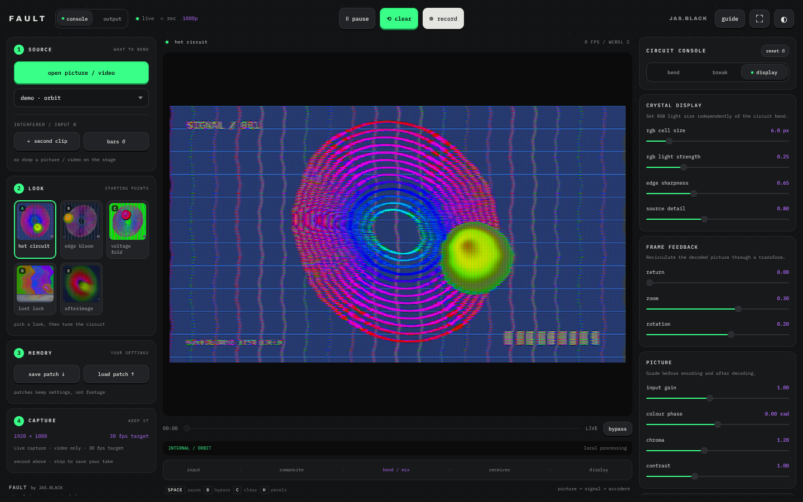

# FAULT by JAS.BLACK

Version 0.4.2

**An experimental video instrument for resonant circuit bending, dirty signal mixing and feedback.** By [JAS.BLACK](https://jas.black).

**[Open it: fault.jas.black](https://fault.jas.black)** · **[The guide: every control, how it works](docs/GUIDE.md)**



FAULT encodes a picture or video into a simplified composite signal, then bends it. Resonant filter bands, voltage folding, signal feedback and a loose sync detector are all played live from a console. Everything runs on your GPU in the browser. Nothing is uploaded and no account is needed.

## Quick start

1. Open [fault.jas.black](https://fault.jas.black) in a current desktop Chrome. WebGL 2 with floating-point rendering is required.
2. The built-in Orbit source is already running. Try the **hot circuit**, **voltage fold** and **lost lock** looks.
3. Click **open picture / video**, or drop a file anywhere on the page. Pictures, animated GIF / WebP / PNG, and videos all work. Drop onto **interferer / input b** to load the second signal.
4. Press **record** to capture 1080p video (no audio). Use **save patch** to keep your settings.

| Key | Action |
| --- | --- |
| Space | Pause / resume |
| B | Clean bypass |
| C | Clear signal and frame memory |
| H | Hide / show side panels |

Double-click any slider to reset it. See the **[guide](docs/GUIDE.md)** for every control and the processing model.

## Run locally

FAULT ships as a single self-contained file. Download [`FAULT.html`](FAULT.html) and open it in Chrome. It works offline.

## Development

```
src/            editable source
  index.html    markup
  style.css     styles
  engine.js     WebGL 2 shader pipeline
  app.js        controls, generators, media, recording
  fonts/        Archivo + IBM Plex Mono (SIL OFL)
  looks/        look thumbnails, rendered from the engine
build.py        inlines src/ into FAULT.html
FAULT.html      built single-file edition (committed)
main.cjs        Electron desktop shell
public/         icons, web manifest and link-preview card (deployed beside the page)
design/         sources for the icons and card
test/           headless shader pipeline checks (Linux, EGL/Mesa)
```

Edit files in `src/`, then rebuild and commit `FAULT.html` with your changes:

```sh
python3 build.py
```

You can also open `src/index.html` directly while working. CI fails if `FAULT.html` is out of date with `src/`.

### Shader checks

On Linux with system EGL/Mesa and Pillow:

```sh
node test/capture-shaders.cjs
python3 test/gpu_check.py
```

Output goes to `test-results/`, which is git-ignored.

### Desktop app (Electron)

```sh
npm install
npm start             # run the desktop shell
npm run build:mac     # unsigned .app directory in dist/
```

Signing and notarisation are not configured. The Electron build is untested.

## Deployment

Every push to `main` runs [`.github/workflows/pages.yml`](.github/workflows/pages.yml). It checks the JavaScript, makes sure `FAULT.html` matches `src/`, and publishes it to GitHub Pages as `index.html` at **fault.jas.black**.

One-time setup:

1. In the repo, open **Settings → Pages** and set **Source** to **GitHub Actions**.
2. In the same page, set **Custom domain** to `fault.jas.black` and turn on **Enforce HTTPS** once the certificate is ready.
3. At your DNS provider, add a `CNAME` record: `fault` → `<your-github-username>.github.io`.

## Status

FAULT 0.4 is an experimental prototype. It has been checked in headless Chromium (rendering, looks, theme, recording) and its shaders compile and render under Mesa. Real-GPU performance on a Mac, Safari and the Electron shell have not been verified. See [docs/VALIDATION.md](docs/VALIDATION.md) for details and [CHANGELOG.md](CHANGELOG.md) for history.

FAULT is an original work. It contains no code, presets, binaries or media from Timecode, GLAZE or other video tools, and no Code Painter media or processing code.

## Licence and credits

Code: [MIT](LICENSE). 
Design, concept and direction by JAS.BLACK. Part of the JAS.BLACK tool family with [Code Painter](https://paint.jas.black), [SnipSnap](https://snap.jas.black) and [Growth](https://growth.jas.black). Fonts: [Archivo](src/fonts/archivo-OFL.txt) and [IBM Plex Mono](src/fonts/ibmplexmono-OFL.txt), both under the SIL Open Font License 1.1.
